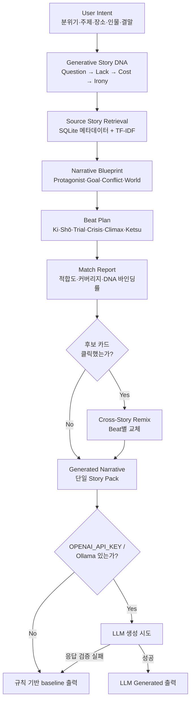

# Narrative Lab

<p align="center">
  
  
  
  
  
  
</p>

제주 설화 246편의 **검색용 메타데이터**와, 새 이야기를 만들 때 쓰는 **생성용 Story DNA**를 분리해서 설계하고, 그 DNA를 Beat Plan의 제약 조건으로 묶어 설화를 재조합하는 로컬 Narrative Engine입니다. 외부 의존성 없는 표준 라이브러리로 동작하며, OpenAI/Ollama는 선택 사항입니다.

## 프로젝트 질문

> 검색용으로 구조화된 기존 설화 데이터로부터 새로운 생성용 Story DNA를 설계하고, 이를 서사 생성의 제약 조건으로 사용하면 재조합 이야기의 일관성을 개선할 수 있는가?

## 무엇을 만들었나

| | |
| --- | --- |
| **문제** | Beat(Ki·Shō·Trial·Crisis·Climax·Ketsu)를 그냥 이어붙이면 재조합 설화의 인과가 끊어집니다. 검색에 쓰는 메타데이터만으로는 "왜 이 사건 다음에 이 사건이 오는가"를 보장하지 못합니다. |
| **해결** | 검색용 Stored Story DNA와 별개로, Question·Lack·Cost·Irony 4요소로 인과 구조를 갖는 Generative Story DNA를 설계해 Narrative Blueprint와 Beat Plan의 제약 조건으로 씁니다. 선택적으로 OpenAI/Ollama를 연결해 자연어 생성까지 확장하되, 응답이 깨지면 규칙 기반 baseline으로 안전하게 대체합니다. |
| **규모** | 설화 246편·Beat 1,264개·모듈 1,431개(팀 ChromaDB), 고정 검색 평가 36문항(fallback 18 + team 18), 테스트 파일 7개 |
| **개발** | 1인 개발 · 2026-08-23 ~ 2026-10-21(약 2개월) · 커밋 22개 · 기획·엔진·프런트엔드·평가 전부 |
| **상태** | 로컬 실행 MVP(`python app.py`), 공개 배포 없음 |

## 어떻게 동작하는가



기본 생성 경로는 하나의 중심 Story Pack만 사용하는 `recombined baseline`입니다. 후보 카드를 클릭했을 때만 선택한 Beat를 다른 설화 사건으로 교체하는 `Cross-Story Remix`로 전환됩니다. 기능별 목적·입력·출력·한계는 [기능 문서 목록](docs/features/README.md)에 정리돼 있습니다.

## 기술적 도전과 해결

**1. 선택적 LLM 응답이 깨져도 "생성 성공"으로 보였던 문제**

OpenAI Responses API가 불완전 응답·타입 오류·refusal·디코딩 실패를 반환해도 기존 코드는 이를 걸러내지 못하고 깨진 결과를 그대로 내보낼 수 있었습니다. 응답의 구조·완료 상태(`status`)·제목과 본문 형식을 검증해, 하나라도 어긋나면 서버를 중단하지 않고 규칙 기반 baseline으로 대체하도록 고쳤습니다. 외부 호출 없는 mock 회귀 테스트를 추가해 `tests/test_provider_boundary.py` 포함 unittest **31개**, 고정 검색 **36문항**(fallback 18 + team 18), API·Chromium smoke 테스트까지 통과를 확인했습니다.

**2. 기본 Pack에 없는 Beat는 유효한 Remix도 무시되던 문제**

중심 Story Pack에 특정 Beat(예: Crisis)가 없으면, 사용자가 다른 설화의 유효한 override를 선택해도 조용히 무시됐습니다. 호환되는 다른 Pack의 override를 누락된 Beat에 실제로 적용하고, 존재하지 않는 ID나 Beat를 요청하면 400으로 명확히 거절하도록 고쳤습니다. unittest **27개**에 더해 Playwright 기반 Chromium으로 후보 카드 클릭 → `applied module ID` → `active_modules` 반영까지 실제 브라우저에서 검증하고, CI에 독립된 browser job을 연결했습니다.

**3. 수정 전/후 효과를 구분할 고정 평가가 없던 문제**

검색 로직을 바꿔도 "실제로 나아졌는지"를 같은 자료·같은 질문으로 반복 측정할 방법이 없었습니다. fallback·team 데이터셋 각 18문항에 정답 ID와 본문 근거를 고정하고, 평가 결과에 자료·코드의 SHA256을 함께 저장해 미커밋 상태와 섞이지 않게 했습니다. 측정 결과: team 데이터셋(설화 246편, 어휘 다양성 높음) synonym 적용 시 recall@1 **0.633**·recall@3 **0.767**, fallback 데이터셋(설화 4편) synonym 적용 시 recall@1 **0.8125**·recall@3 **0.969**이며, 동의어 확장으로 회귀 없이 3문항(Q10·Q14·Q16)이 개선됐습니다.

## 구조·스택 선택 이유

- **검색은 벡터가 아니라 SQLite 메타데이터 + TF-IDF lexical baseline.** 팀이 만든 ChromaDB의 벡터는 직접 쓰지 않고, 저장된 메타데이터만으로 신선한 Python 환경에서 바로 실행되게 했습니다. 모듈별 raw TF-IDF 점수와 매칭 단어를 화면에 그대로 보여줄 수 있어, 왜 이 설화가 선택됐는지를 설명 가능하게 유지합니다.
- **핵심 엔진은 외부 의존성 없는 표준 라이브러리.** `app.py`는 `http.server`만으로 동작해 신규 환경에서 설치 없이 바로 실행됩니다. LLM(OpenAI·Ollama)은 선택 계층으로 분리해, 없어도 전체 파이프라인이 결정적으로 동작합니다.
- **Generative Story DNA와 Stored Story DNA의 분리.** 검색에 쓰는 메타데이터(`wounds_addressed`, `emotional_arc` 등)와, 매 생성 요청마다 설계되는 인과 구조(Question→Lack→Cost→Irony)를 다른 계층으로 둬서, 검색 결과가 바뀌어도 생성 제약은 흔들리지 않게 했습니다.
- **평가 하네스를 코드 커밋에 고정.** `evaluation/retrieval.py` 결과 JSON에 코드·데이터 SHA256을 같이 저장해, 재현 불가능한 수치가 README나 PR에 들어가지 않게 했습니다.

## 실행

```bash
python app.py
```

브라우저에서 [http://127.0.0.1:8000](http://127.0.0.1:8000)을 엽니다. 서버 코드를 수정하면 `Ctrl + C`로 종료 후 다시 실행하고, 브라우저는 `Ctrl + F5`로 새로고침합니다.

```bash
python -m unittest discover -s tests -v
```

선택적으로 로컬 LLM(Ollama)이나 OpenAI를 연결할 수 있습니다.

```powershell
# Ollama
$env:NARRATIVE_USE_OLLAMA = "1"
$env:NARRATIVE_OLLAMA_MODEL = "qwen2.5:3b"

# 또는 OpenAI
$env:OPENAI_API_KEY = "your_api_key_here"
$env:NARRATIVE_OPENAI_MODEL = "gpt-4o-mini"  # 선택 사항

python app.py
```

키가 없거나 요청이 실패하면 서버는 멈추지 않고 규칙 기반 baseline(`recombined baseline`)으로 돌아갑니다. 응답에는 `generated.generation_mode`가 `LLM Generated` 또는 `recombined baseline`으로 표시됩니다.

## 한계

- 검색이 벡터가 아닌 어휘(TF-IDF) 기반이라 의미는 같지만 어휘가 다른 질의는 놓칩니다. 실제로 어휘가 다양한 team 데이터셋(246편)의 recall@1(0.633)이 어휘가 단순한 fallback 데이터셋(4편, 0.8125)보다 낮게 나옵니다.
- 평가 정답(gold)은 저장된 `event_text`에서 끌어온 "development gold"로, 독립적인 사람 검토가 아직 없습니다(평가 결과 파일의 `annotation_review` 필드에 명시).
- 응답 형식 검증(구조·완료 상태·제목/본문 존재)만 끝났고, 생성된 이야기 본문이 실제로 Story DNA의 인과(Question→Lack→Cost→Irony)와 일치하는지는 아직 자동 검증하지 않습니다. 다음 단계(MVP2.0-C)로 남겨 뒀습니다.
- Cross-Story Remix는 사용자가 후보 카드를 직접 클릭해야만 발동하며, 기본 생성 경로는 항상 단일 Story Pack입니다.
- 공개 배포 없이 로컬 실행만 검증했습니다.

## 더 보기

- [기능별 문서](docs/features/README.md) — 기능 단위 목적·입력·출력·한계
- [검색 평가](docs/STORY_RETRIEVAL_EVALUATION.md) — 고정 질문·raw 결과·지표
- [일관성 규칙](docs/STORY_CONSISTENCY_RULES.md) — Remix 입력 검증과 실패 경계

### Match Report 해석

- `Story Pack 적합도`: 전체 후보 설화 중 선택된 원천 설화의 상대 순위
- `Beat 구조 커버리지`: 선택된 설화가 setup·transition·conflict·climax·resolution 중 제공하는 구조 수
- `DNA 바인딩률`: 생성용 DNA 역할이 실제 원천 사건에 연결된 비율
- `원천 일관성`: 여러 설화를 섞지 않고 하나의 Story Pack에서 모듈을 선택했는지

점수는 의미·문학 품질에 대한 절대 평가가 아니라, 검색과 생성의 연결 과정을 투명하게 보여주는 설명 지표입니다.
